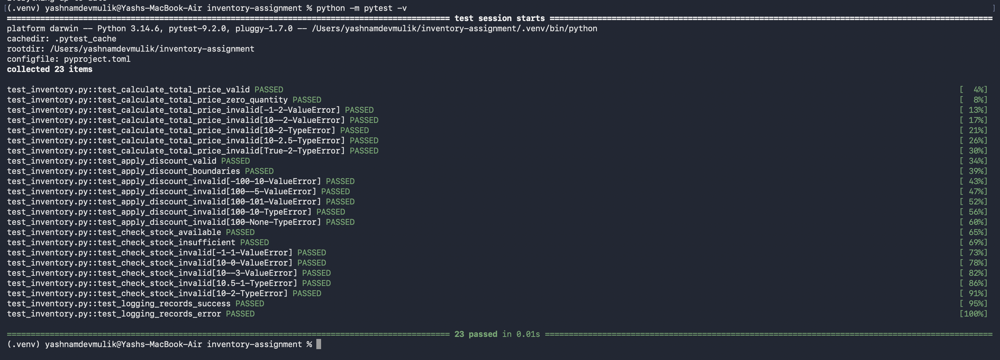
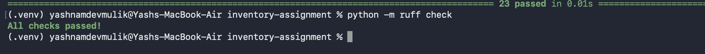

# Product Inventory Management System

A small Python application with three validated, logged helper functions:

| Function | Purpose |
| --- | --- |
| `calculate_total_price(price, quantity)` | Returns `price * quantity` |
| `apply_discount(total, discount_percent)` | Returns the amount after the percentage discount |
| `check_stock(available_stock, requested_quantity)` | Returns `True` if the request can be fulfilled |

Invalid input raises `TypeError` (wrong type) or `ValueError` (out-of-range value). Every check, success and error is logged.

## Setup (macOS)

```bash
git clone https://github.com/yashmulik3126/product-inventory.git
cd product-inventory

python3 -m venv .venv
source .venv/bin/activate
pip install -r requirements.txt
```

After activation the prompt starts with `(.venv)`.

## Run the demo

```bash
python inventory.py
```

Logs print to the terminal and are saved to `inventory.log`.

## Run the tests

```bash
python -m pytest -v
```

## Ruff (lint and format)

```bash
python -m ruff check .
python -m ruff format .
```

## Project structure

```
inventory.py        # application code
test_inventory.py   # pytest tests
requirements.txt
pyproject.toml      # Ruff settings
.gitignore          # excludes .venv
evidence/           # test and Ruff screenshots
```

## Test and Ruff output



